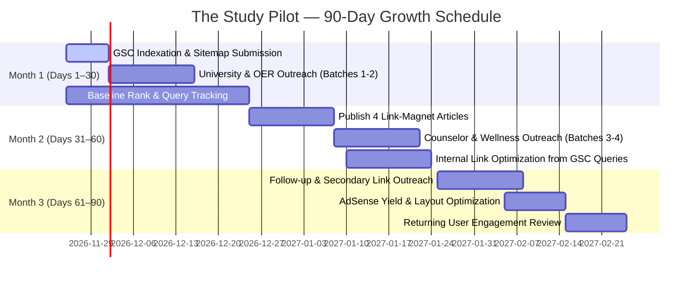

# The Study Pilot — 90-Day Organic Growth Roadmap & Master Project Summary

**Website**: https://thestudypilot.space  
**Brand**: The Study Pilot  
**Author**: Senior SEO Strategist & Engineering Team  
**Date**: November 2026  
**Document**: Final Strategy Guide & 90-Day Operational Blueprint  

---

## Part 1: Complete Project Overview (Phases 0 through 13)

Over 14 systematically executed phases, **The Study Pilot** was transformed from an isolated student productivity app into a comprehensive, high-authority educational web ecosystem. Crucially, this extension was achieved **with zero disruption** to the original application core, preserving all user local storage keys, timer engines, streak tracking algorithms, Google Analytics 4 (`G-DN0QM74VWJ`), and Google AdSense (`ca-pub-7967739323765266`).

```mermaid
graph TD
    A["The Study Pilot (thestudypilot.space)"] --> B["1. Core Web App (/app)"]
    A --> C["2. Blog & Guide Hub (/blog)"]
    A --> D["3. Interactive Tools Suite (/tools)"]
    A --> E["4. Free Student Resource Library (/resources)"]
    A --> F["5. Trust & Legal Pages (/about, /privacy, /terms, /contact)"]

    B --> B1["Focus Study Timer & Stopwatch"]
    B --> B2["52-Week Habit Heatmap"]
    B --> B3["Multi-Exam Countdown Roadmaps"]
    B --> B4["Subject Target Management"]

    C --> C1["Pillar: Study Schedule Blueprint"]
    C --> C2["10 Supporting Educational Guides"]
    C --> C3["TOC, Progress Bar, Schemas"]

    D --> D1["Study Planner Generator"]
    D --> D2["Weekly Study Planner"]
    D --> D3["Study Hours Calculator"]
    D --> D4["Pomodoro Focus Timer"]
    D --> D5["Study Habit Tracker"]
    D --> D6["Consistency Calculator"]
    D --> D7["Exam Countdown Tracker"]
    D --> D8["Exam Prep Progress Calculator"]

    E --> E1["10 High-Contrast Printable Sheets"]
    E --> E2["Interactive Print & PDF Modal"]
    E --> E3["Dedicated Print CSS Isolation"]
```

### Milestone & Phase Recap:
- **Phase 0 — Website Audit & Safety Analysis**: Documented existing architecture, router system, local storage keys, and zero-regression boundaries.
- **Phase 1 — SEO Strategy & Content Architecture**: Formulated an 8-cluster keyword and topic architecture covering 30 high-intent search themes.
- **Phase 2 — Blog Infrastructure**: Created dynamic `SEOHead`, article layouts, reading progress bars, author cards, category filtering, and Schema.org structured data.
- **Phase 3 — Pillar Article**: Published the authoritative guide *"How to Create a Study Schedule You Can Actually Follow"* (3,500+ words, 21 TOC sections, 3h college & 6h exam blueprints).
- **Phase 4 — First Three Interactive Tools**: Built the Study Planner Generator, Weekly Study Planner, and Study Hours Calculator.
- **Phase 5 — Remaining Five Interactive Tools**: Built the Pomodoro Timer, Habit Tracker, Consistency Calculator, Exam Countdown, and Exam Prep Progress Calculator.
- **Phase 6 — Supporting Content Cluster**: Published 10 high-value educational guides (25,000+ words total) across study habits, procrastination, multi-subject planning, and exam strategy.
- **Phase 7 — Free Student Resource Library**: Created the `/resources` hub and 10 printable high-contrast PDF/print sheets with dedicated `@media print` CSS.
- **Phase 8 — Internal Linking & Topical Authority**: Formulated bidirectional cross-linking across all 27 pages and introduced the Ecosystem Showcase on the homepage.
- **Phase 9 — Technical SEO & Performance**: Synchronized `robots.txt` and `sitemap.xml` (27 canonical URLs), created `og-image.svg` (1200x630), and implemented JSON-LD structured data.
- **Phase 10 — Ethical Backlink Prospecting**: Compiled a verified 100-target academic prospect directory with 5 customized, non-spammy outreach email templates.
- **Phase 11 — Link-Worthy Content & Competitor Gap Analysis**: Identified 5 critical competitor content gaps and designed 4 flagship link-magnet blueprints.
- **Phase 12 — Final Quality Assurance**: Executed a 20-point comprehensive audit across routing, math formulas, print rules, analytics, and build performance.
- **Phase 13 — Final Report & 90-Day Organic Growth Roadmap**: Handed off the operational schedule and indexation protocol.

---

## Part 2: Search Console Setup & Indexation Acceleration Protocol

To ensure search engines rapidly crawl and index all 27 canonical URLs without delay:

### Step 1: Google Search Console (GSC) Verification
1. Log in to [Google Search Console](https://search.google.com/search-console).
2. Add Property as **URL Prefix**: `https://thestudypilot.space/`.
3. Verify ownership using the existing Google Analytics 4 integration (`G-DN0QM74VWJ`) or HTML tag method.

### Step 2: Sitemap Submission
1. In the GSC left navigation, navigate to **Indexing > Sitemaps**.
2. Under "Add a new sitemap", enter: `sitemap.xml`.
3. Click **Submit**. Verify that the status shows **Success** and 27 URLs are discovered.

### Step 3: Priority Indexing Requests (URL Inspection Tool)
Manually submit the top 6 priority URLs for immediate indexing via the "URL Inspection" search bar in GSC:
1. `https://thestudypilot.space/` (Homepage Ecosystem)
2. `https://thestudypilot.space/blog/how-to-create-a-study-schedule` (Pillar Guide)
3. `https://thestudypilot.space/resources` (Free Resource Library)
4. `https://thestudypilot.space/tools` (Interactive Tools Hub)
5. `https://thestudypilot.space/tools/study-planner-generator` (Core Tool)
6. `https://thestudypilot.space/blog/how-to-study-consistently` (High-Search Intent Article)

### Step 4: Bing Webmaster Tools Integration
1. Open [Bing Webmaster Tools](https://www.bing.com/webmasters).
2. Click **Import from Google Search Console**.
3. Confirm sitemap detection at `https://thestudypilot.space/sitemap.xml`.

---

## Part 3: The 90-Day Organic Growth Operational Roadmap

---

### Month 1: Indexation, Baseline Calibration & Initial Academic Outreach (Days 1–30)

#### Week 1 (Days 1–7): Setup & Discovery
- Submit `sitemap.xml` to Google Search Console and Bing Webmaster Tools.
- Request manual indexing on the top 6 pillar URLs.
- Verify Google Analytics 4 Realtime report is capturing organic landings with clean page paths.
- Audit AdSense crawler access in the AdSense console (`Sites > Status: Ready`).

#### Week 2 (Days 8–14): Batch 1 Outreach (University Academic Centers)
- Select the first 15 targets from Category 1 in `docs/seo/backlink-prospecting-database.md` (e.g. Dartmouth, Harvard ARC, UNC Learning Center, Cornell).
- Use **Template A** (University Academic Resource / LibGuide Coordinator).
- Ensure personalized greeting and mention of specific student time management handouts.
- Log date and contact details in the pipeline tracking sheet.

#### Week 3 (Days 15–21): Batch 2 Outreach (OER & Digital Libraries)
- Select 15 targets from Category 3 (MERLOT, OER Commons, OpenStax, LibreTexts, OpenLearn).
- Highlight that The Study Pilot is 100% free, signup-free, and respects student data privacy.
- Send a polite, single follow-up to any unacknowledged emails from Week 2.

#### Week 4 (Days 22–30): First GSC Performance Review
- Review GSC **Performance > Search Results**:
  - Filter for queries receiving impressions but low clicks (rankings between position 8 and 25).
  - Note secondary keyword variations that real students are searching for.
  - Review click-through rates (CTR) on page titles and meta descriptions.

---

### Month 2: Content Expansion, Counselor Outreach & Query Optimization (Days 31–60)

#### Week 5 (Days 31–37): Publish Link-Magnet Asset 1 & 2
- Publish the **Syllabus Triage & Emergency Recovery Decision Tree** (designed in Phase 11).
- Publish the **Evidence-Based Study Methods Comparison Matrix** (designed in Phase 11).
- Add new entries to `sitemap.xml` with priority 0.9.
- Connect new articles to `/tools/exam-preparation-progress` and `/tools/pomodoro-timer`.

#### Week 6 (Days 38–44): Batch 3 Outreach (High School Guidance & Counselors)
- Select 15 targets from Category 2 in `docs/seo/backlink-prospecting-database.md` (ASCA, PrepScholar, College Essay Guy, Coalition for College).
- Use **Template B** (High School Counselor / College Prep Director).
- Pitch the Free Student Resource Library (`/resources`) for in-person counseling handouts.

#### Week 7 (Days 45–51): Publish Link-Magnet Asset 3 & 4
- Publish the **Realistic Study Time Estimation Formula & Planning Fallacy Guide**.
- Publish the **52-Week Student Consistency Benchmark & Heatmap Framework**.
- Connect articles to `/tools/study-hours-calculator` and `/tools/study-consistency-calculator`.

#### Week 8 (Days 52–60): Batch 4 Outreach (Student Wellness & ADHD Centers)
- Select 10 targets from Category 5 (CHADD, ADDitude, Understood.org, Active Minds, Student Minds UK).
- Use **Template C** (Student Wellness & Neurodiversity Coordinator).
- Pitch the distraction-free Pomodoro timer and guilt-free consistency metrics.

---

### Month 3: Link Acquisition Follow-Up, AdSense Yield & User Retention (Days 61–90)

#### Week 9 (Days 61–67): Secondary Outreach & Roundup Pitching
- Select 10 targets from Category 4 (Productivity Curators like Thomas Frank community, Zapier, Asian Efficiency) and Category 6 (Free Software Curations).
- Use **Template D** (Educational Blogger / EdTech Tool Curator).
- Pitch The Study Pilot for inclusion in "Best Free Student Productivity Tools" roundups.

#### Week 10 (Days 68–74): Broken Link Replacement Campaigns
- Conduct manual link checks on academic resource pages using tools like Check My Links.
- When an expired or dead link to an old study planner is discovered, deploy **Template E** (Broken Resource Replacement Pitch).

#### Week 11 (Days 75–81): Google AdSense Yield & Layout Optimization
- Review AdSense revenue, eCPM, and viewability scores:
  - Verify auto-ads or ad units render strictly below-the-fold or between article content blocks.
  - Ensure zero intrusive vignettes or interstitial ads interrupt active study timers or print workflows.
  - Confirm high adherence to Google AdSense Better Ads Standards.

#### Week 12 (Days 82–90): Comprehensive Quarterly Audit & Long-Term Strategy
- Evaluate quarterly KPIs:
  - Total organic search impressions and clicks.
  - Number of earned educational (.edu / .org) backlinks.
  - Number of printable PDF worksheets downloaded/printed.
  - Returning user rate for the core application (`/app`).
- Plan the next quarter's content roadmap based on top-performing search queries.

---

## Part 4: Monthly SEO Hygiene & Ongoing Maintenance Checklist

| Frequency | Task | Procedure |
|:---:|:---|:---|
| **Weekly** | Search Console Errors Check | Inspect **GSC > Pages** for any crawl 404s, redirect anomalies, or indexing exclusions. |
| **Bi-Weekly** | Broken Link Audit | Run automated link checker to ensure outbound references and internal links remain active. |
| **Monthly** | Core Web Vitals Audit | Review **GSC > Core Web Vitals** to ensure LCP (< 2.5s), INP (< 200ms), and CLS (< 0.1) remain green. |
| **Monthly** | AdSense Policy Review | Inspect **AdSense > Policy Center** to ensure 0 policy violations or ad-serving restrictions. |
| **Quarterly** | Content Freshness Update | Review and update examination blueprints, year dates (e.g. 2026/2027), and reading lists. |
| **Quarterly** | Test Suite Execution | Run `npm test -- --run` and `npm run build` after any dependency or styling upgrades. |

---

## Part 5: Master Ecosystem Directory (All 27 Live Routes)

1. **Homepage Ecosystem**: `https://thestudypilot.space/`
2. **About & Methodology**: `https://thestudypilot.space/about`
3. **Blog & Guides Hub**: `https://thestudypilot.space/blog`
4. **Pillar Guide (Study Schedule Blueprint)**: `https://thestudypilot.space/blog/how-to-create-a-study-schedule`
5. **Study Consistently Guide**: `https://thestudypilot.space/blog/how-to-study-consistently`
6. **Stop Procrastinating Guide**: `https://thestudypilot.space/blog/how-to-stop-procrastinating-while-studying`
7. **Plan Multiple Subjects Guide**: `https://thestudypilot.space/blog/how-to-plan-multiple-subjects`
8. **Track Study Time Guide**: `https://thestudypilot.space/blog/how-to-track-study-time`
9. **Pomodoro vs Deep Work Guide**: `https://thestudypilot.space/blog/pomodoro-technique-vs-deep-work`
10. **Weekly Study Plan Guide**: `https://thestudypilot.space/blog/how-to-create-a-weekly-study-plan`
11. **Competitive Exam Study Plan Guide**: `https://thestudypilot.space/blog/competitive-exam-study-plan`
12. **Study with Limited Time Guide**: `https://thestudypilot.space/blog/how-to-study-with-limited-time`
13. **Restart Studying Guide**: `https://thestudypilot.space/blog/how-to-restart-studying-after-losing-motivation`
14. **Build a Study Habit Guide**: `https://thestudypilot.space/blog/how-to-build-a-study-habit`
15. **Free Student Resource Library**: `https://thestudypilot.space/resources`
16. **Interactive Tools Hub**: `https://thestudypilot.space/tools`
17. **Study Planner Generator**: `https://thestudypilot.space/tools/study-planner-generator`
18. **Weekly Study Planner**: `https://thestudypilot.space/tools/weekly-study-planner`
19. **Study Hours Calculator**: `https://thestudypilot.space/tools/study-hours-calculator`
20. **Pomodoro Study Timer**: `https://thestudypilot.space/tools/pomodoro-timer`
21. **Study Habit Tracker**: `https://thestudypilot.space/tools/study-habit-tracker`
22. **Study Consistency Calculator**: `https://thestudypilot.space/tools/study-consistency-calculator`
23. **Exam Countdown Tracker**: `https://thestudypilot.space/tools/exam-countdown`
24. **Exam Preparation Progress Calculator**: `https://thestudypilot.space/tools/exam-preparation-progress`
25. **Privacy Policy**: `https://thestudypilot.space/privacy`
26. **Terms of Service**: `https://thestudypilot.space/terms`
27. **Contact Support**: `https://thestudypilot.space/contact`
