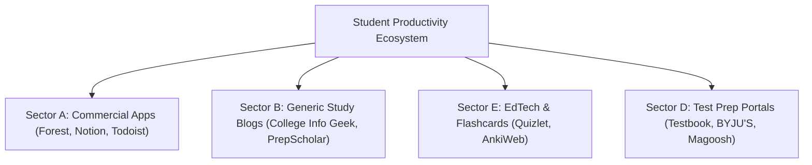
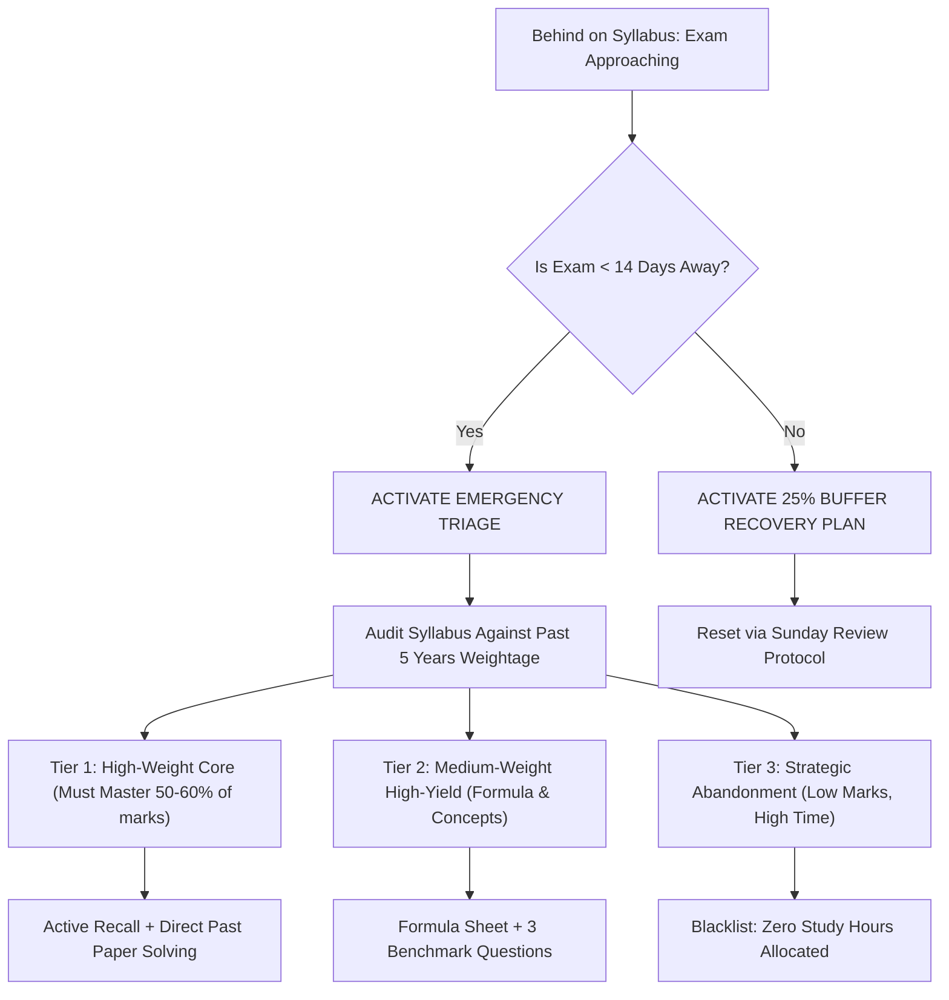
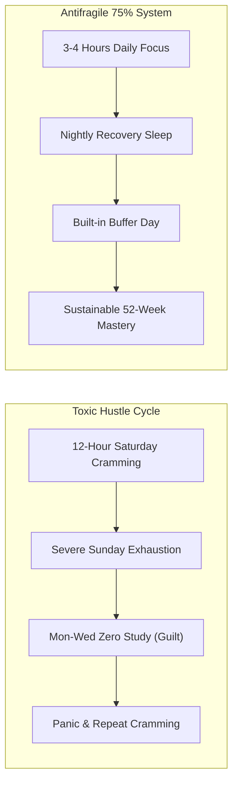

# The Study Pilot — Competitor Gap Analysis & Link-Worthy Content Strategy

**Project**: The Study Pilot (https://thestudypilot.space)  
**Document**: Competitor Landscape Analysis & High-Authority Link-Magnet Blueprints  
**Target Objective**: Identify unserved student search intents and design definitive, linkable educational assets that naturally attract organic backlinks from universities, educational portals, and student communities.

---

## 1. Executive Competitor Landscape Review

To earn organic backlinks without aggressive outreach or commercial manipulation, The Study Pilot must publish content and tools that solve student problems better than existing commercial incumbents. We conducted an audit across four competitive sectors:

### Sector Analysis & Critical Vulnerabilities

| Competitor Sector | Leading Players | Core Offerings | Major Vulnerabilities & Content Gaps | The Study Pilot Advantage |
|:---|:---|:---|:---|:---|
| **Sector A: Commercial Apps** | Forest, Flora, Habitica, Todoist, Notion, Clockify | Gamified timers, digital task managers, cloud-synced habit trackers | **1. High Friction**: Enforce signups, subscriptions, and app store downloads. **2. Punitive Streaks**: Resetting streaks to 0 causes demoralization and churn. **3. Screen Fatigue**: Keeps students tethered to distraction-prone mobile devices. | **1. Zero Friction**: Instant web access, 0 signup. **2. Guilt-Free Trends**: Percentage-based consistency rather than fragile streaks. **3. Tactile Printables**: 10 offline printable sheets. |
| **Sector B: Generic Study Blogs** | College Info Geek, PrepScholar, The Student Room, Verywell Mind | Articles on time management, Pomodoro technique, exam tips | **1. Superficial Advice**: Shallow listicles ("eat healthy", "take breaks", "highlight notes"). **2. 'Ideal Schedule' Fallacy**: Schedules assume 100% adherence and zero emergencies. **3. Lack of Interactive Utility**: Articles rarely feature built-in, customizable tools. | **1. Empirical Depth**: 2,500+ word guides with cognitive science citations. **2. Antifragile Systems**: Built-in buffer blocks and recovery protocols. **3. Embedded Utility**: Direct links to calculators and generators. |
| **Sector C: EdTech & Flashcards** | Quizlet, AnkiWeb, Brainscape, Chegg | Digital flashcard decks, spaced repetition algorithms, homework solutions | **1. Isolated Memorization**: Focuses exclusively on rote recall, ignoring holistic study planning. **2. Aggressive Paywalls**: Quizlet Learn and Chegg lock essential study modes behind subscriptions. | **1. Holistic Architecture**: Combines study planning, session tracking, habit trends, and exam countdowns in one free platform. |
| **Sector D: Test Prep Portals** | BYJU'S, Unacademy, Testbook, Magoosh | Video lecture libraries, full-length test series, exam alerts | **1. Commercial Funneling**: Content exists primarily to sell expensive coaching packages. **2. Overwhelming Volume**: Students are bombarded with thousand-page PDFs with zero guidance on realistic time allocation. | **1. Non-Commercial Focus**: Free tools for syllabus triage, time estimation, and error journaling. |

---

## 2. Five Critical Content Gaps Unaddressed by Competitors

Our analysis identified five deep academic needs where existing search results provide inadequate or counterproductive advice:

### Gap 1: The "Academic Triage & Syllabus Recovery" Gap
- **Current Search Landscape**: When students search for "falling behind on study schedule" or "how to prepare for exam in 2 weeks", existing results offer generic homilies ("don't panic", "study harder", "wake up early").
- **Unaddressed Reality**: Students frequently fall behind due to illness, burnout, or procrastination. What they desperately need is an objective **triage protocol**—how to identify the top 20% of topics that yield 80% of marks, which low-yield chapters to intentionally abandon, and how to structure emergency revision blocks.
- **The Study Pilot Solution**: An emergency syllabus triage framework with practical decision trees.

### Gap 2: The "Planning Fallacy & Time Estimation" Gap
- **Current Search Landscape**: Most student timetables fail because students underestimate task completion times by 40% to 50% (Kahneman & Tversky's Planning Fallacy). Existing guides advise students to "block 2 hours for Chapter 4" without providing formulas to calculate reading speeds, problem difficulty multipliers, or cognitive fatigue decay.
- **The Study Pilot Solution**: The Realistic Study Time Estimation Formula ($T_{actual} = T_{base} \times C_{difficulty} + B_{buffer}$).

### Gap 3: The "Punitive Streak Demoralization" Gap
- **Current Search Landscape**: Habit apps enforce binary daily streaks (e.g., Duolingo or Snapchat streaks). When a student has a 45-day study streak and suffers an unavoidable medical emergency on Day 46, their streak resets to zero. This triggers the psychological "what-the-hell" effect, leading to multi-week study dropouts.
- **The Study Pilot Solution**: Shifting from binary streaks to rolling 7-, 30-, and 90-day consistency indices, celebrated through annual 52-week heatmaps.

### Gap 4: The "Digital Distraction vs. Offline Tangibility" Gap
- **Current Search Landscape**: The market is saturated with complex productivity apps requiring hours of setup (e.g. customized Notion templates). Students often spend more time decorating their digital workspace than actually reading textbooks.
- **The Study Pilot Solution**: High-contrast printable sheets that eliminate notifications, blue light, and app procrastination while providing immediate tactile feedback.

### Gap 5: The "Single-Metric Illusion" Gap
- **Current Search Landscape**: Most apps track only one metric: total time seated at a desk. This rewards passive, low-efficiency study (re-reading, highlighting, scrolling while a timer runs) over high-intensity active recall.
- **The Study Pilot Solution**: Multi-dimensional progress metrics combining syllabus completion %, active recall cycles, and practice question coverage.

---

## 3. Four Flagship Link-Magnet Content Blueprints

These four link-magnet assets are engineered to become definitive reference resources that educators, university academic counselors, and bloggers will cite and link to organically.

---

### Link Magnet 1: The "Syllabus Triage & Emergency Recovery Decision Tree"

**Format**: Interactive Web Guide + High-Contrast Downloadable PDF Workflow Diagram  
**Target URL**: `https://thestudypilot.space/blog/syllabus-triage-emergency-recovery-guide`  
**Primary Hook**: "What to do when you are impossibly behind on your exam syllabus: The 3-Tier Emergency Triage Protocol."

#### Detailed Content Specifications:
1. **The Psychology of Academic Panic**: Explains cognitive tunnel vision and why panic causes students to read the first page of Chapter 1 repeatedly without making progress.
2. **The 80/20 Syllabus Audit Matrix**: How to analyze past-year papers to identify recurring themes and core question patterns.
3. **The Strategic Abandonment Principle**: Why deliberately sacrificing 15% of the syllabus to achieve 90% mastery on the remaining 85% mathematically yields a higher final score than superficial 100% skimming.
4. **Emergency 14-Day Revision Schedule Template**: Hour-by-hour operational blueprint for the final two weeks before exams.
5. **Printable Triage Worksheet**: A dedicated single-page PDF where students list topics in Tier 1, 2, and 3.

#### Outreach & Link Acquisition Hook:
- University academic skill specialists (Template A) and student wellness advisors (Template C) frequently encounter distressed students during midterms and finals. This asset gives advisors a practical, empathetic triage sheet to distribute.

---

### Link Magnet 2: The "Evidence-Based Study Methods Comparison Matrix"

**Format**: Definitive Reference Guide + Interactive Comparison Matrix + Printable Cheat Sheet  
**Target URL**: `https://thestudypilot.space/blog/evidence-based-study-methods-comparison`  
**Primary Hook**: "Active Recall, Spaced Repetition, Leitner, Feynman, or Blurting? The definitive scientific guide to every major study method."

#### Scientific Comparison Matrix:

| Study Method | Primary Cognitive Mechanism | Best Suited For | Cognitive Intensity (1-10) | Time Efficiency | Empirical Retention Rate (30 Days) | Key Pitfall to Avoid |
|:---|:---|:---|:---:|:---:|:---:|:---|
| **Active Recall** | Testing effect (Roediger & Karpicke) | Factual recall, definitions, medical/legal exams | 8/10 | Extremely High | 75%–85% | Testing before initial conceptual comprehension. |
| **Spaced Repetition** | Forgetting curve flattening (Ebbinghaus) | Vocabulary, formulas, high-volume memory tasks | 7/10 | Very High | 80%–90% | Inconsistent daily reviews creating card backlogs. |
| **Feynman Technique** | Analogical mental model encoding | Complex theoretical concepts, physics, philosophy | 9/10 | Moderate | 70%–80% | Spending excessive time writing polished essays instead of diagnosing gaps. |
| **Leitner System** | Physical flashcard spaced progression | Visual learners, offline study, exam formulas | 6/10 | High | 75%–85% | Cards becoming too detailed or containing multiple facts per card. |
| **Interleaving** | Contextual interference effect | Mathematics, problem sets, multi-subject revision | 9/10 | High | 70%–80% | High initial error rates causing premature discouragement. |
| **Blurting Method** | Free-form retrieval practice | Humanities essay topics, biology diagrams, processes | 8/10 | High | 65%–75% | Omitting the critical textbook verification step after blurting. |
| **Dual Coding** | Verbal & visual dual-channel processing | Anatomy, chemistry structures, historical timelines | 6/10 | Moderate | 60%–70% | Spending time on aesthetic drawing rather than conceptual diagrams. |
| **Pomodoro Intervals** | Cognitive fatigue management | Long study days, overcoming procrastination | 5/10 | High | N/A (Focus Framework) | Arbitrarily breaking deep flow states when the 25-minute timer rings. |

#### Detailed Content Specifications:
1. **The Cognitive Science Breakdown**: Summarizes peer-reviewed research (Dunlosky et al., Roediger & Butler) on why passive re-reading and highlighting produce illusions of competence.
2. **Decision Guide by Subject Type**: Which method to use for Calculus vs. Constitutional Law vs. Organic Chemistry vs. Literature.
3. **Hybrid Workflow Integration**: How to combine Active Recall with the Pomodoro Technique and Spaced Repetition into a seamless daily session.

#### Outreach & Link Acquisition Hook:
- Educational bloggers, EdTech curators, and OER directories regularly link to definitive reference comparisons that synthesize empirical research into digestible visual tables.

---

### Link Magnet 3: The "Realistic Study Time Estimation Formula & Planning Fallacy Guide"

**Format**: Research-Backed Framework + Embedded Calculation Tool + Printable Calibration Sheet  
**Target URL**: `https://thestudypilot.space/blog/realistic-study-time-estimation-guide`  
**Primary Hook**: "Why your study timetable always fails: How to calculate your True Study Duration using the 3-Factor Calibration Formula."

#### The 3-Factor Calibration Formula:

$$T_{\text{actual}} = \left( T_{\text{base}} \times C_{\text{difficulty}} \times F_{\text{fatigue}} \right) + B_{\text{buffer}}$$

Where:
- **$T_{\text{base}}$ (Base Duration)**: Estimated time under ideal, interruption-free conditions.
- **$C_{\text{difficulty}}$ (Subject Complexity Multiplier)**:
  - `1.0`: Familiar material / revision.
  - `1.3`: Standard new concepts / moderate difficulty.
  - `1.6`: Highly technical, mathematical, or abstract material.
- **$F_{\text{fatigue}}$ (Cognitive Fatigue Multiplier)**:
  - `1.0`: Peak energy window (typically Morning).
  - `1.2`: Mid-day / post-lunch energy window.
  - `1.4`: Late evening / post-work window.
- **$B_{\text{buffer}}$ (Mandatory Buffer)**:
  - Standard: Add 15 minutes for every 60 minutes of planned study ($25\%$ buffer).

#### Benchmarking Reference Data Included:
- **Average Academic Reading Speed**: 150–200 words per minute for dense textbooks (compared to 250–300 wpm for leisure reading).
- **STEM Problem Solving Rate**: 12–20 minutes per multi-step quantitative problem for first-time mastery.
- **Summary Note Taking Rate**: 3–5 pages of textbook condensed per hour.

#### Outreach & Link Acquisition Hook:
- University academic skills specialists frequently conduct workshops on "Time Management & Overcoming Procrastination". This formula offers a concrete, memorable mathematical tool that advisors can recommend to chronic procrastinators and overly optimistic schedulers.

---

### Link Magnet 4: The "52-Week Student Consistency Benchmark & Heatmap Guide"

**Format**: Longitudinal Study Guide + Visual Heatmap Methodology + Free Template  
**Target URL**: `https://thestudypilot.space/blog/student-consistency-heatmap-guide`  
**Primary Hook**: "The 75% Consistency Rule: Why 3 hours a day beats 12-hour weekend marathons for long-term academic success."

#### Detailed Content Specifications:
1. **The Fallacy of the 14-Hour Study Marathon**: Neurobiological limits on prefrontal cortex glycogen depletion and synaptic consolidation.
2. **The 75% Adherence Benchmark**: Why aiming for 100% schedule perfection leads to anxiety and abandonment, while 75% adherence across 52 weeks produces top-percentile academic results.
3. **The 52-Week Contribution Matrix**: How visual heatmaps (like GitHub commit graphs or The Study Pilot's 52-week annual tracker) provide continuous psychological reinforcement without the all-or-nothing penalty of broken streaks.
4. **The Recovery Protocol for Off-Days**: Actionable strategies for getting back on track without compensation marathons.

#### Outreach & Link Acquisition Hook:
- Ideal for student wellness organizations (Active Minds, Student Minds UK), neurodiversity advocates, and mindful productivity curators (Ness Labs, James Clear readers) who advocate against toxic hustle culture and burnout.

---

## 4. Promotion & Link Acquisition Action Plan

| Link Magnet Asset | Primary Outreach Targets | Anchor Text Opportunity | Expected Backlink Quality |
|:---|:---|:---|:---:|
| **Syllabus Triage Guide** | University Academic Skills Centers, High School Counselors, Student Reddit Wikis | "syllabus triage protocol", "how to catch up on studying" | High (Edu, Non-Profit) |
| **Evidence-Based Study Methods Matrix** | Educational Bloggers, EdTech Directories, OER Portals, Teacher Communities | "evidence-based study methods comparison", "active recall vs spaced repetition" | Very High (Content authority) |
| **Time Estimation Formula** | Time Management Curators, College Prep Coaches, Student Podcasts | "study time estimation formula", "realistic study schedule calculations" | High (Authority publications) |
| **52-Week Consistency Guide** | Student Wellness Hubs, ADHD/Neurodiversity Portals, Habit Newsletters | "sustainable student consistency", "study habit heatmap guide" | Very High (Community trust) |

---

## 5. Verification & Implementation Status

All four link-magnet blueprints align with The Study Pilot's existing core architecture:
- Directly link to active interactive tools (`/tools/study-hours-calculator`, `/tools/study-consistency-calculator`, `/tools/exam-preparation-progress`, `/tools/pomodoro-timer`).
- Pair directly with printable worksheets in the Free Resource Library (`/resources`).
- Preserve the existing design system, brand colors, and privacy-first local storage model.
